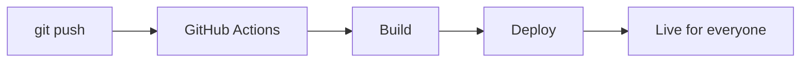

<h1 align="center">
  
</h1>

<p align="center">
  
  
  
</p>

<p align="center">
  <b>AI আৰু টেকৰ জৰিয়তে অসমত সকলোৰে ওচৰলৈ সমানেৰে তথ্য পৌঁছাই দিবলৈ কাম কৰি আছোঁ — যাতে কোনেও পিছ পৰি নাথাকে।</b>
</p>

<p align="center">────────────  ◆  ────────────</p>

```text
┌─────────────────────────────────────────────┐
│  $ whoami                                   │
│  > axomiya-indie  |  indie dev   │
│                                             │
│  $ cat mission.txt                          │
│  > equal access to knowledge, for everyone  │
│                                             │
│  $ ./build --for assam --with ai            │
│  > status: building . . . . . . .           │
└─────────────────────────────────────────────┘
```

## About

Axomiya Indie is an Assam-based independent developer building AI-first tools and education platforms to make high-quality information accessible to everyone in both Assamese and English. The mission is simple: remove language, location, and resource barriers using technology.

## লক্ষ্য

> **ছাত্ৰ আছিলোঁ। এতিয়া AI গঢ়ি আছোঁ — যাতে আন ছাত্ৰ-ছাত্ৰীয়ে আগবাঢ়িব পাৰে।**
> **সমান সুযোগ, সকলোৰে বাবে।**

## মই কি বনাওঁ

| Project | What it is | Stage |
| :--- | :--- | :--- |
| **PrepBuddy** | Exam preparation platform for students in Assam | `[x] build  [x] test  [ ] live` |
| **AxomiyaGPT** | AI that understands and speaks proper Assamese | `[~] build  [ ] test  [ ] live` |
| **Asomiya Quiz** | Quiz platform, 1,000+ students signed up | `[x] build  [x] test  [x] live` |
| **Education Platform** | Equal access to learning resources | `[~] build  [ ] test  [ ] live` |
| **Learning Game** | Skill-building through play | `[~] build  [ ] test  [ ] live` |

```text
Status:  [x] = done    [~] = in progress    [ ] = not yet
```

> হাজাৰ হাজাৰ মানুহৰ জীৱনত প্ৰভাৱ পেলোৱাৰ লক্ষ্যৰে আগবাঢ়ি আছোঁ।

## How I Work

```text
+----------+    +----------+    +----------+    +----------+    +----------+
|   IDEA   | -> | VALIDATE | -> |  BUILD   | -> |   TEST   | -> |   SHIP   |
|          |    | with AI  |    |AI assist |    |          |    |          |
+----------+    +----------+    +----------+    +----------+    +----------+
      ^                                                               |
      |                                                               |
      +----------------------- LEARN & IMPROVE -----------------------+

AI assistants:  Claude  |  ChatGPT  |  Gemini  |  DeepSeek | Grok 
```

From a git push to a live site, with no manual steps:



## Tech Stack

<p align="center">
  
  
  
  
  <br/>
  
  
  
  
  
  
  <br/>
  
  
  
  
  <br/>
  
  
  
  
  <br/>
  
  
  
  <br/>
  
  
  
  
  <br/>
  
  
  
  
</p>

## Philosophy

```text
Real output  >  empty talk.
Code, not noise.
```

> *Technology should not create gaps. It should remove them.*

## Focus

- ▸ Assam-first products
- ▸ Accessibility and digital inclusion
- ▸ Student and youth empowerment
- ▸ Local-to-global impact

## Collaborate

Building something meaningful in **AI**, **education**, **community tech**, or **open source**? Let's talk.

**অসমৰ বাবে, ভৱিষ্যতৰ বাবে।**

<p align="center">
  <a href="https://www.linkedin.com/in/axomiyaindie/">
    
  </a>
  <a href="https://x.com/AxomiyaIndie">
    
  </a>
  <a href="https://www.facebook.com/share/17gMFEg3Y6/">
    
  </a>
</p>

<p align="center">────────────  ◆  ────────────</p>

<p align="center">
  <b>Read my blog</b><br/>
  I dive into everything tech, share my personal opinions, and write useful guides<br/>
  so anyone can build and learn freely, the way I did: through trial and error.
</p>

<p align="center">
  <a href="https://axomiyaindie.github.io/">
    
  </a>
</p>

<p align="center">
  <a href="https://git.io/streak-stats"></a>
</p>

```text
  < made with code, curiosity and chai, in Assam >
```

<h3 align="center">
  
</h3>