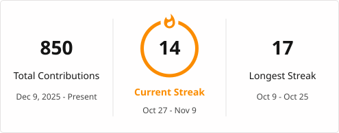

Hey, I'm an indie developer from Assam.

I'm building AI-first tools and education platforms so everyone can access quality information in both Assamese and English. I write guides and opinions on tech on my blog [here](https://axomiyaindie.github.io/), everything I learned through trial and error.

> ছাত্ৰ আছিলোঁ। এতিয়া AI গঢ়ি আছোঁ — যাতে আন ছাত্ৰ-ছাত্ৰীয়ে আগবাঢ়িব পাৰে।

If you're building something in AI, education, community tech or open source, I'd love to collaborate. You can reach me on [LinkedIn](https://www.linkedin.com/in/axomiyaindie/), [X](https://x.com/AxomiyaIndie) or [Facebook](https://www.facebook.com/share/17gMFEg3Y6/).

Building

* AxomiyaGPT - AI that understands and speaks proper Assamese.
* Education Platform - Equal access to learning resources.
* Learning Game - Skill-building through play.

Founder of

* [Axomiya IT Labs](https://axomiya-it-labs.github.io/) - Free, open-source tools and developer platforms for Assam. [GitHub](https://github.com/Axomiya-IT-Labs)

Focus: Assam-first products, accessibility and digital inclusion, student and youth empowerment, local-to-global impact.

**অসমৰ বাবে, ভৱিষ্যতৰ বাবে।**
